<p align="center">
  <picture>
    <source media="(prefers-color-scheme: dark)" srcset="docs/logo/dark.svg">
    <source media="(prefers-color-scheme: light)" srcset="docs/logo/light.svg">
    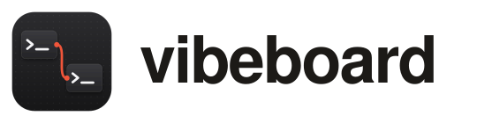
  </picture>
</p>

<p align="center">
  <a href="https://github.com/ricca200xx/vibeboard/releases/latest"></a>
  <a href="https://github.com/ricca200xx/vibeboard/releases"></a>
  <a href="LICENSE"></a>
  <a href="#download"></a>
  <a href="#build-from-source"></a>
</p>

<p align="center"><b>All your coding agents on one board. Real terminals, side by side.</b></p>

<p align="center">
  <a href="#download">Download</a> |
  <a href="#quick-start">Quick start</a> |
  <a href="#templates">Templates</a> |
  <a href="#what-you-can-do">Features</a> |
  <a href="#how-it-works">How it works</a> |
  <a href="#privacy-and-security">Security</a> |
  <a href="#build-from-source">Build from source</a>
</p>

<p align="center">
  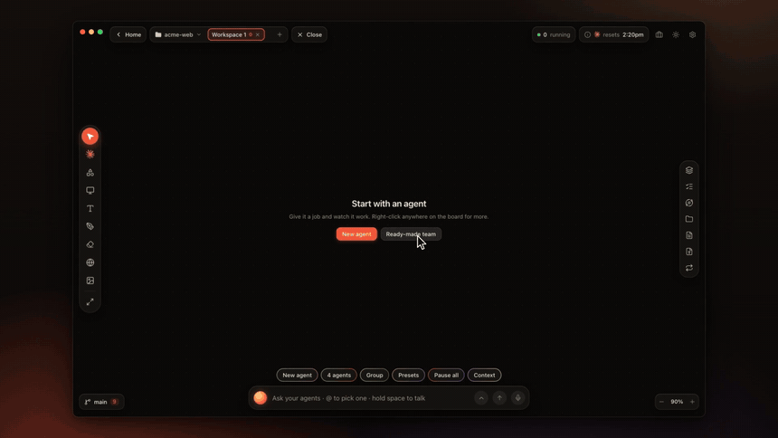
</p>

<p align="center">
  <b>Download the Mac app:</b>
  <a href="https://github.com/ricca200xx/vibeboard/releases/latest/download/vibeboard-mac-arm64.dmg">Apple silicon</a> ·
  <a href="https://github.com/ricca200xx/vibeboard/releases/latest/download/vibeboard-mac-x64.dmg">Intel</a>
</p>

vibeboard is an open-source Mac app that puts the coding agents you already use, such as Claude Code,
Codex, Gemini CLI, Cursor and more, on one infinite canvas. Every console is a real terminal running
the real CLI, with your own sign-in and your own shell. Agents can be grouped into teams and hand their
work to one another. You can see what each one is doing and how full its memory is.

Not at home in a terminal? Any agent can also show a plain conversation, with buttons when it asks
something. The real terminal keeps running underneath, one click away.

## Quick Start

### Install the app

1. Download the disk image for your Mac:
   - **[Apple silicon](https://github.com/ricca200xx/vibeboard/releases/latest/download/vibeboard-mac-arm64.dmg)** (M1 and later);
   - **[Intel](https://github.com/ricca200xx/vibeboard/releases/latest/download/vibeboard-mac-x64.dmg)**.

   Not sure which? Apple menu › **About This Mac**: **Chip: Apple M…** means Apple silicon,
   **Processor: Intel** means Intel.
2. Open the `.dmg` and drag **vibeboard** into **Applications**.
3. The first time you open it, macOS says it cannot check the app, because vibeboard is not yet signed
   with a paid Apple Developer ID. Press **Done**. Then open **System Settings › Privacy & Security**,
   scroll down and press **Open Anyway**. You only do this once.

**You need** macOS 13 Ventura or later and at least one agent CLI, for example
[Claude Code](https://docs.anthropic.com/en/docs/claude-code). If vibeboard finds none, it offers to set
up Claude Code: it types the install command into a terminal and you press Return to run it.

**To update**, replace the app in Applications with the new one. Your boards are kept.

### Your first team

1. **Open a project folder.** Each project keeps its own boards, called workspaces.
2. Press **Presets** at the bottom and pick a team, for example **Plan, build, review**. Or press
   **New agent** for a single one.
3. **Give the first agent the job**, in its terminal or in its simple view. When it finishes, its work
   passes to the next agent on its own.
4. **Answer when an agent asks.** The question shows as buttons, with the command or the edit written out.
5. **Make your own teams.** Drag one terminal onto another to group them. Then drag the dot on a
   console's edge onto another console to pass work along.

> Try: *"Add a `shout(name)` function to src/greet.js that returns the greeting in capitals."*
> The planner writes three steps, the builder asks before editing the file, and the reviewer checks the result.

### From the source

```bash
git clone https://github.com/ricca200xx/vibeboard.git
cd vibeboard
npm install
npm run desktop    # the Mac app, from the source
```

See [Build from source](#build-from-source) for everything else.

## Templates

Ready-made teams under **Presets**. Each one opens as a group with its roles set and its wires in place;
every member runs your default agent, and its role travels with each hand-off it receives.

<table>
  <tr>
    <td width="50%" align="center" valign="top">
      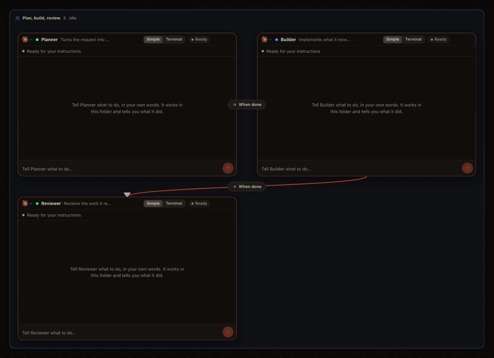
      <br><b>Plan, build, review</b>
      <br><sub>Planner → Builder → Reviewer. A planner breaks the job down, a builder does it, a reviewer checks it.</sub>
    </td>
    <td width="50%" align="center" valign="top">
      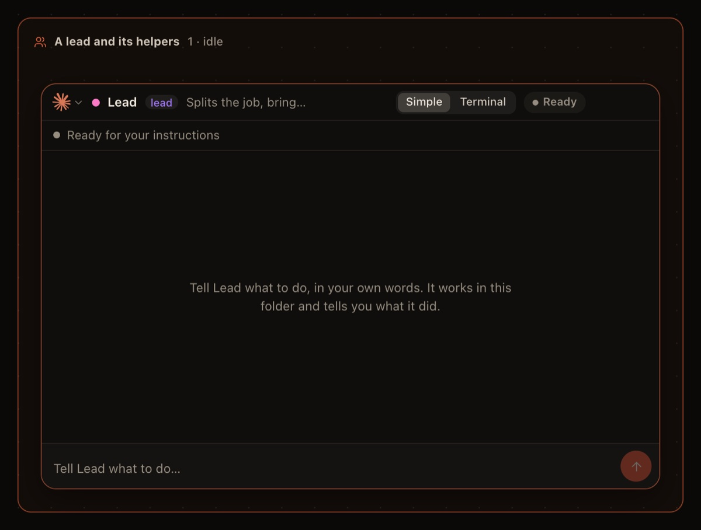
      <br><b>A lead and its helpers</b>
      <br><sub>Give one agent the job. When it splits into parts, it brings helpers onto the board and combines their work.</sub>
    </td>
  </tr>
  <tr>
    <td width="50%" align="center" valign="top">
      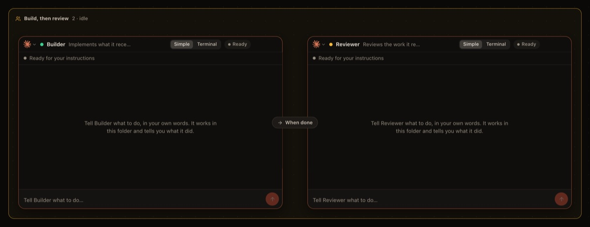
      <br><b>Build, then review</b>
      <br><sub>Builder → Reviewer. One agent does the work, a second checks it when it is done.</sub>
    </td>
    <td width="50%" align="center" valign="top">
      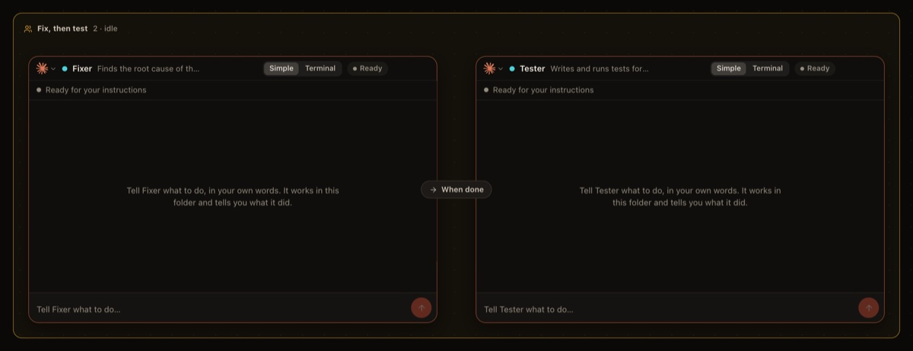
      <br><b>Fix, then test</b>
      <br><sub>Fixer → Tester. One agent fixes the bug, another writes and runs tests for the fix.</sub>
    </td>
  </tr>
  <tr>
    <td width="50%" align="center" valign="top">
      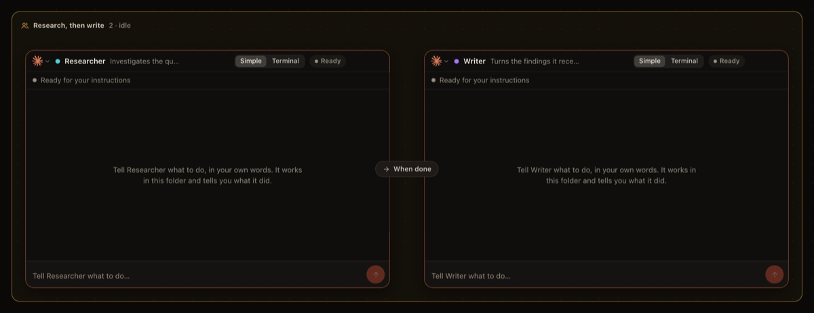
      <br><b>Research, then write</b>
      <br><sub>Researcher → Writer. One agent digs through the code and docs, another writes it up.</sub>
    </td>
    <td width="50%" align="center" valign="top">
      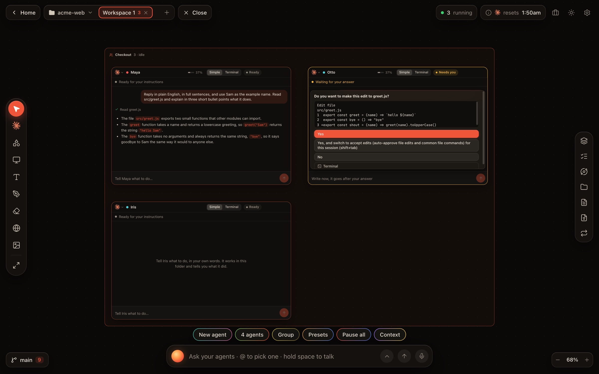
      <br><b>Your own</b>
      <br><sub>Any agents, any wires. Save a mix of agents as a preset and start it again in one click.</sub>
    </td>
  </tr>
</table>

## What You Can Do

- **Run many agents at once**, each in a real terminal, with your own `PATH` and sign-ins.
- **Orchestrate them.** Wires pass work from one agent to the next:
  - *when done*: the first one's work goes on when it finishes;
  - *every reply*: each reply is forwarded;
  - *only if*: the work goes on only if a pattern appears;
  - *review*: the second one checks until it says APPROVED;
  - *shared context*: the second one gets the first one's context once.

  An **Orchestrator** card sends one order to every agent wired to it. A **lead** Claude brings in
  helpers by itself.
- **Talk to them from one place.** In the command bar, `@Maya fix the failing test` goes to one agent and
  `@Checkout` to a whole group. Plain words ("spawn three Claudes in a group called Docs") become board
  actions. Hold Space to dictate.
- **Use the simple view when you want one**: a status line, the conversation, buttons for questions, and
  a write box that never locks. A message waits for its turn and can be taken back.
- **See what fills their memory.** Each Claude shows how full its context is, what fills it, and offers
  Compact and Clear. The **Context** panel puts every agent side by side.
- **Connect your other folders.** A second brain or a notes folder outside the project, connected under
  Context › Folders, is reachable by Claude and opens in the studios.
- **Work with the code without a terminal**:
  - **Git**: changes and diffs, snapshots, upload and download;
  - **Code**, **Markdown** and **Documents** studios;
  - **diagrams of the repo** drawn on the board.
- **Keep them going.** Loops repeat an instruction on a schedule, when an agent goes idle, or when its
  output matches. You get notified when an agent needs you.
- **More**:
  - exact sizes for terminals and web pages;
  - web tiles with your dev servers one click away;
  - notes, shapes and ink;
  - kanban boards, checklists and calendars;
  - two accounts of the same CLI side by side;
  - a mission map of everything running;
  - light and dark themes.

<table>
  <tr>
    <td width="50%" align="center" valign="top">
      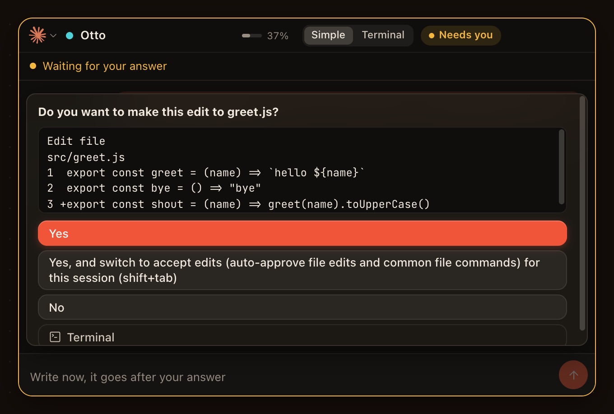
      <br><sub>Questions become buttons, with the edit written out.</sub>
    </td>
    <td width="50%" align="center" valign="top">
      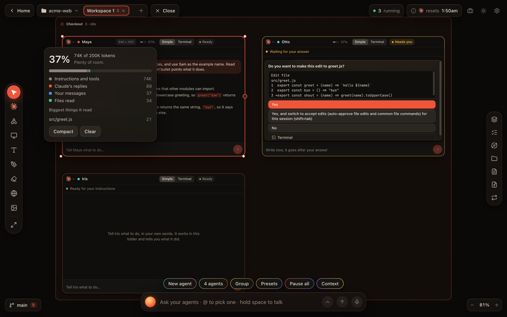
      <br><sub>What fills an agent's memory, and what to do about it.</sub>
    </td>
  </tr>
  <tr>
    <td width="50%" align="center" valign="top">
      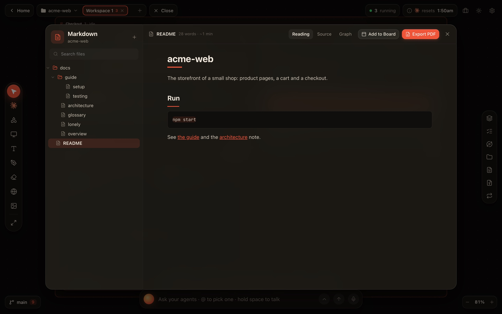
      <br><sub>Every note in the project, or in a connected folder.</sub>
    </td>
    <td width="50%" align="center" valign="top">
      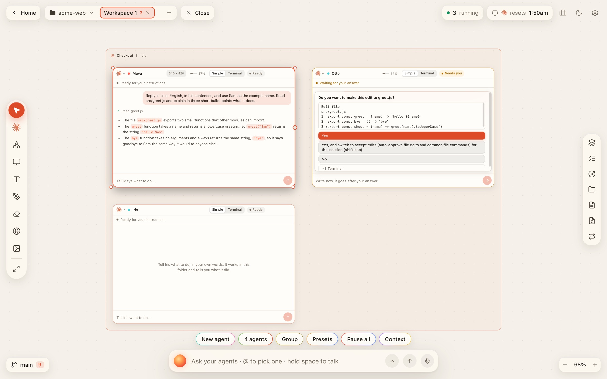
      <br><sub>Light and dark, following the system.</sub>
    </td>
  </tr>
</table>

## How It Works

- The app starts a small server on `127.0.0.1:4317` and shows the board in a window. Nothing else on
  your network can reach it.
- Every console is a real pseudo-terminal running your agent CLI through your login shell.
  - Consoles keep running while you switch workspaces.
  - They reattach with their scrollback.
  - A console that floods the output is paused until the screen catches up.
- **Claude Code:**
  - vibeboard adds its status hooks with `--settings` for each session;
  - it reads Claude's own transcript for the conversation, the steps and the context gauge;
  - your global Claude configuration is never changed.
- **Other agents** are followed by their output.
- **Questions on screen** ("Do you want to proceed?") become buttons:
  - a button only presses the keys you would press;
  - before it does, the server checks that the same question is still on screen and that the right option is highlighted.
- **Hand-offs:**
  - the next agent gets a short summary of the first one's work;
  - its final reply goes along word for word.
- **Your data:** boards live in `~/.vibeboard/`. No account, no cloud, no telemetry.

## Supported Agents

Claude Code · Codex · Gemini CLI · Aider · Cursor CLI · Qwen Code · OpenCode · Grok · Amp · Goose ·
Copilot CLI · Droid · Crush · Kimi CLI · Auggie · Cline · Kilo Code · Codebuff · Continue, and a plain shell.
vibeboard runs whichever of them are installed and on your `PATH`.

|                                                  | **Claude Code**       | **Other agents**     |
| ------------------------------------------------ | --------------------- | -------------------- |
| Real terminal, groups, wires, loops, command bar | yes                   | yes                  |
| Buttons for the questions it asks                | yes                   | when it draws a menu |
| Working / Needs you / Done                       | exact, from its hooks | from its output      |
| Conversation in the simple view, context gauge   | yes                   | not yet              |
| Connected folders                                | yes (`--add-dir`)     | tell it the path     |
| Resume, lead and helpers                         | yes                   | not yet              |
| A second account                                 | yes                   | Codex                |

## Why vibeboard?

- **Real terminals, not a wrapper.** The CLI you know runs as it is, with your settings, plugins and
  sign-in. Nothing is emulated, and the terminal is always one click away.
- **Built for several agents.** Groups, wires, reviews and an orchestrator replace a wall of terminal tabs.
- **Plain words for everyone.** Every control says what it does. A person who never opened a terminal
  can follow what an agent is doing and answer it.
- **You stay in charge.** Nothing is approved on your behalf. Auto-approve exists, and it is off unless you turn it on.
- **Local and open.** Your Mac, your sign-ins, your files. MIT licensed.

## Keyboard

| Key                             | What it does                                     |
| ------------------------------- | ------------------------------------------------ |
| ⌫ or Delete                     | Close what is selected, consoles included        |
| ⌘Z                              | Bring back what was just closed                  |
| ⌘0                              | Fit the whole board in view                      |
| Esc                             | Leave the current tool, menu or panel            |
| Hold Space                      | Dictate into the command bar (not while typing)  |
| Shift- or ⌘-click               | Select several things                            |
| Double-click a console's header | Show it at 100%                                  |
| Right-click                     | A menu for the board or for what is under it     |

## Privacy and Security

- **Who can reach the server:**
  - it listens on `127.0.0.1` only and accepts requests only from its own page;
  - it checks Origin and Host, which also stops DNS rebinding;
  - it refuses requests that other websites send through images, scripts or links.
- **It has no password.** Any program running as you on the same Mac can drive your consoles. Do not forward the port.
- **The app's own page** runs only its own scripts (Content-Security-Policy). Every piece of Markdown it shows is sanitized.
- **Web pages inside the board** are kept apart from it. In the app they cannot use your camera,
  microphone, location or notifications.
- **Agents keep their usual permission prompts.** **Auto-approve** (Claude's `--dangerously-skip-permissions`) is off unless you turn it on.
- **What leaves your Mac:**
  - vibeboard itself sends nothing anywhere; the agents talk to their own providers as they always do;
  - dictation uses the browser's speech service, which may send audio to its vendor;
  - in the app, use the Mac's own dictation instead: press fn twice.

Found a security problem? Please report it privately through
[GitHub's security advisories](https://github.com/ricca200xx/vibeboard/security/advisories/new), not in a public issue.

## Your Data and Removing vibeboard

| What                                      | Where                                       |
| ----------------------------------------- | ------------------------------------------- |
| Boards, memories, loops, account profiles | `~/.vibeboard/` (with a backup of the board) |
| The app's window settings                 | `~/Library/Application Support/vibeboard/`  |
| Logs                                      | `~/Library/Logs/vibeboard/server.log`       |

To remove vibeboard:
1. Quit it.
2. Move it from Applications to the Bin.
3. Delete the three folders above.

Your projects and your agents' own settings are not touched.

## Troubleshooting

- **"vibeboard cannot be opened"**: see [Install the app](#install-the-app). This happens once.
- **An agent shows as "not installed"**:
  - vibeboard looks for it in your login shell's `PATH`;
  - check that `which claude` (or the agent's command) works in a new Terminal window;
  - then press **Check again**.
- **"vibeboard could not start"**: another program is using port 4317. A second copy of vibeboard, or
  `npm run dev`, is reused on its own. Otherwise, quit that program, or look in the log.
- **A console says the project's folder is gone**: it was moved or deleted. Open the folder from its new place.
- **Dictation does nothing in the app**: use the Mac's own dictation (fn twice) in the command bar.

## Build from Source

You need Node.js 24 or later.

```bash
npm install
npm run dev        # server on 127.0.0.1:4317, app on http://localhost:5173
npm test           # the test suite (it starts its own server in a throwaway folder)
npm run desktop    # the Mac app, from the source
npm run dist       # both disk images, in release/
```

- `npm run build && npm start` serves the built app on `http://127.0.0.1:4317` in your browser. In a
  browser, sites such as Google refuse to show inside a web tile; in the Mac app every site loads.
- A tag such as `v0.2.0` builds both disk images on GitHub Actions and leaves them on a draft release.

## Community

- Bugs and ideas: [GitHub Issues](https://github.com/ricca200xx/vibeboard/issues)
- Security reports: [private advisory](https://github.com/ricca200xx/vibeboard/security/advisories/new)
- Contributions: pull requests are welcome. Run `npm test` before you open one.

## Credits

- **Agent marks:** they come from [Lobe Icons](https://github.com/lobehub/lobe-icons) (MIT). They stay
  the trademarks of their owners and only name the tool a console runs; see `src/assets/agents/NOTICE.md`.
- **Independent project:** vibeboard is inspired by [Symvibe](https://www.symvibe.com/). It is not
  affiliated with or endorsed by Symvibe, Apple, Anthropic or any agent's maker, and it uses no code or
  assets from them.

## License

[MIT](LICENSE) © 2026 Riccardo Niccolò Agosti
